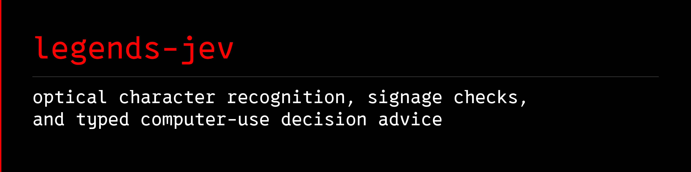
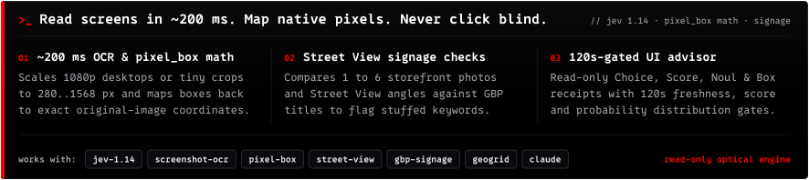
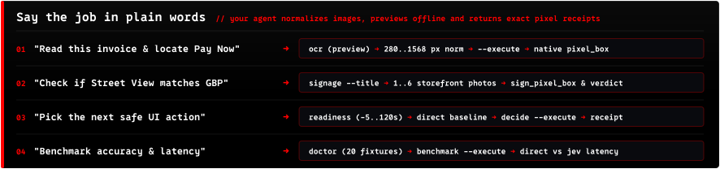
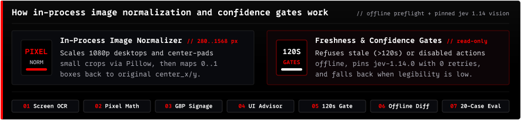
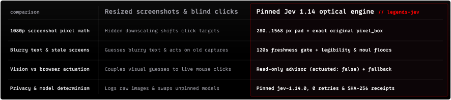

<a name="banner"></a>
<a name="legends-jev"></a>

# 

[](https://github.com/avalonreset/legends-jev/releases/latest)
[](https://github.com/avalonreset/legends-jev/actions/workflows/checks.yml)
[](pyproject.toml)
[](legends_jev/core.py)
[](LICENSE)

**Python OCR, original-image screenshot pixel coordinates, Street View storefront signage verification, and confidence-gated UI action advisor CLI (`legends-jev`) for coding agents: normalize 1080p desktops or small crops into `280..1568` px bounds in-process, map returned bounding boxes back to exact native `pixel_box` (`center_x`, `center_y`) coordinates in ~200 ms, audit Google Business Profile titles against real storefront photos for [`legends-geogrid`](https://github.com/avalonreset/legends-geogrid), and keep vision strictly read-only (`actuated: false`).**


```text
Install or update legends-jev via cto-legends (https://github.com/avalonreset/cto-legends): run `cto-legends install legends-jev --apply`, then `cto-legends handoff legends-jev` and follow the returned JSON recipe to verify `legends-jev doctor`.
```



## Why `legends-jev` exists

Browser tests, desktop automations, and local SEO map audits routinely break when visual verification is left to ad-hoc chat uploads or unguarded computer-use loops:

1. **Hidden screenshot downscaling shifts UI click coordinates:** Upload a `1920x1080` desktop capture or a tiny cropped button into a general chat window and ask where to click, and the model resizes your image internally without exposing its scale or padding ratio. The returned coordinates miss the actual button on your native screen by dozens of pixels.
2. **Guessing on blurry captures, stale screens, and untrusted text:** Unguided vision loops guess text on unreadable captures, act on screenshots taken minutes ago after the window has already changed, or follow adversarial prompt injections embedded inside on-screen text.
3. **Coupling visual guesses directly to live mouse clicks:** Letting an agent move the cursor or trigger shell actions inside the same black-box loop that reads the screen removes your ability to verify confidence scores, readability thresholds, and action permissions before actuation happens.

`legends-jev` wraps the pinned TypeSafe `jev-1.14.0` System One model in a **preview-first, read-only optical and decision CLI** (`actuated: false`). Every `ocr`, `signage`, and `decide` workflow runs an offline preflight and in-process image normalizer first, previews the exact compiled request at zero network cost unless `--execute` is passed, and returns a SHA-256-hashed JSON receipt with exact original-image `pixel_box` coordinates and strict operator fallback gates.

## Ask in plain english

Once [`cto-legends`](https://github.com/avalonreset/cto-legends) is installed, you ask your coding agent in plain english. It normalizes screenshots in-process, previews the request offline, and returns validated coordinates or signage verdicts:



## Architecture: in-process image normalization and confidence gates



### 1. In-process `280..1568` px normalization and original-image `pixel_box` math

TypeSafe's `jev-1.14.0` vision endpoint requires still PNG or JPEG images between `280` and `1568` pixels per side. Instead of failing on full-screen `1920x1080` desktop captures or tiny UI crops:

- **Proportional scaling and centered canvas padding (`prepare_image_bytes`):** `legends-jev` inspects image headers against decompression-bomb limits (`MAX_IMAGE_DIMENSION = 16384`, `MAX_IMAGE_PIXELS = 25000000`), proportionally scales oversized screenshots down to `1568` px on the longest edge, and center-pads undersized crops onto a `280x280` canvas in-process via pure Python and `Pillow>=10.0.0` (unless `--no-normalize` is passed).
- **Exact original-image coordinate reversal (`pixel_box`):** When `jev-1.14.0` returns normalized `0..1` bounding boxes (`top`, `bottom`, `left`, `right`), `pixel_box()` subtracts the canvas padding (`pad_left`, `pad_top`) and divides by the exact scale factor to return native original-image pixel coordinates (`left`, `top`, `right`, `bottom`, `width`, `height`, `center_x`, `center_y`).

### 2. Bounded CLI workflows (`ocr`, `signage`, `decide`, `benchmark`)

Every provider-capable command previews offline by default (`preview: true`, `provider_called: false`) and makes at most one HTTPS call (`30s` timeout, `NoRedirect`, zero automatic retries) when `--execute` is passed:

| Surface | `legends-jev` Subcommands | What It Does |
| :--- | :--- | :--- |
| **Offline Readiness & Guide** | `doctor`, `guide`, `sample` | Validates all 20 packaged synthetic fixtures offline, reports `TYPESAFE_API_KEY` readiness (`credential_present`), prints the packaged operator recipe (`guide`), or emits a fresh UTC sample envelope (`sample`). |
| **Screenshot OCR & Pixel Boxes** | `ocr --goal <goal> --image label=path` | Inspects 1 to 6 PNG/JPEG images to verify 1 to 12 expected strings (`--expect-text`), localize 1 to 4 visual targets (`--locate`) with normalized `box` and native `pixel_box` coordinates, and classify screen state (`--choice`) into `legends-jev/ocr-receipt-v1`. |
| **Street View Signage Audits** | `signage --title <gbp> --suspect-term <term> --image label=path` | Compares 1 to 6 storefront photos, logos, and multi-angle Street View captures against a Google Business Profile title for [`legends-geogrid`](https://github.com/avalonreset/legends-geogrid), returning `supports_full_title`, `omits_suspect_terms`, or `obstructed_or_no_sign` plus `sign_pixel_box` (`legends-jev/signage-receipt-v1`). |
| **UI Action Decision Advisor** | `readiness`, `preview`, `direct`, `decide` | Enforces `-5..120s` observation freshness and surface/permission filters offline (`readiness`), checks an instant exact-match baseline (`direct`), previews the compiled payload (`preview`), or evaluates 1 to 8 candidates with optional optical grounding (`decide --execute`, returning `legends-jev/receipt-v1`). |
| **Synthetic Benchmark & Models** | `benchmark [--execute]`, `models [--execute]` | Runs the 20 packaged synthetic evaluation cases comparing the offline `direct` exact-match baseline against live `jev-1.14.0` accuracy and latency (`benchmark`), or previews/queries `/v1/models` (`models`). |

### 3. Prompt-injection isolation, 120s freshness gates, and zero-raw-evidence receipts

- **Untrusted text isolation (`state.expected_texts` & `state.locate_targets`):** User-supplied `--expect-text` and `--locate` strings are stored strictly inside structured `state` arrays rather than interpolated into question rubric instructions, preventing text inside screenshots or flags from overriding the evaluation rubric.
- **Conservative confidence floors & SHA-256 receipts:** Observations older than `120` seconds, future-dated over `5` seconds, missing eligible candidates, or failing probability distribution, readability (`>= 1.2`), support (`>= 1.8`), insufficiency (`<= 0.2`), or choice confidence (`>= 0.8`) checks return `status: "operator_fallback"`. Saved receipts omit raw evidence text and base64 image bytes, storing only `input_sha256` and validated answers.

## Resized chat screenshots vs `legends-jev`



## Quick start

```sh
# 1. Verify offline health across 20 synthetic fixtures and inspect the operator guide
legends-jev doctor
legends-jev guide

# 2. Preview and execute general-purpose screenshot OCR + original-image pixel_box lookup
legends-jev ocr \
  --goal "Verify invoice status and locate the Pay Now button" \
  --image screen=invoice.png \
  --expect-text "Invoice #1042" \
  --expect-text "Balance Due" \
  --locate "screen:the Pay Now button" \
  --choice "payable=Invoice shows Balance Due and an active Pay Now button" \
  --choice "paid=Invoice is already marked Paid" \
  --execute

# 3. Audit Street View storefront signage against a Google Business Profile title
legends-jev signage \
  --title "DeSano Pizzeria Napoletana" \
  --suspect-term "Pizzeria Napoletana" \
  --image streetview=streetview.jpg \
  --image logo=logo.jpg \
  --execute

# 4. Run offline preflight, exact-match baseline, preview, and gated decision advice
legends-jev sample > evidence.json
legends-jev readiness --input evidence.json
legends-jev direct --input evidence.json
legends-jev preview --input evidence.json
legends-jev decide --input evidence.json --execute --output receipt.json
```

## Reference

<details>
<summary><strong>Credentials, data scope, and EDR safety boundaries</strong></summary>

Provision `TYPESAFE_API_KEY` through your shell environment or pass an explicit `--api-key-file <path>` (which enforces printable-ASCII validation, a 4 KB size bound, and target plus ancestor symlink refusal via `refuse_symlink_tree`). Never place secret values in command lines, source files, `.env` commits, logs, or prompts.

- **Nonsecret scope only (`synthetic`, `public`, `nonsecret-app-metadata`):** Free text and screenshots are not secret detectors; redact sensitive content before submitting. `legends-jev` never captures screens, scrapes local application databases, or uploads unreviewed files on its own.
- **Zero hidden processes or DPAPI scraping:** All image normalization runs strictly in-process via pure Python and `Pillow>=10.0.0`. The CLI never spawns hidden console windows, PowerShell wrappers, or background daemons, and never reads browser profile databases or DPAPI stores.
- **Fail-closed output writing (`--output`):** Input files, image paths, `--api-key-file`, and `--output` paths refuse symlinks across the target and ancestor directory chain, and `--output` refuses to overwrite existing files unless `--overwrite` is explicitly passed.

</details>

<details>
<summary><strong>Agent setup (via <code>cto-legends</code>) and standalone installation</strong></summary>

### Agent setup (via `cto-legends`)

Part of the [cto-legends](https://github.com/avalonreset/cto-legends) ecosystem. `cto-legends` is the only registered skill; this repo vendors a pinned copy at [skills/cto-legends/SKILL.md](skills/cto-legends/SKILL.md). Do not register this module as its own skill.

Run `cto-legends handoff legends-jev` to read the installed module recipe and readiness checks, or preview and apply installation via `cto-legends`:

```sh
cto-legends install legends-jev
cto-legends install legends-jev --apply
cto-legends handoff legends-jev
cto-legends run legends-jev -- doctor
```

For an isolated standalone Python 3.11+ environment:

```sh
python -m venv .venv
# Windows: .venv/Scripts/python.exe; POSIX: .venv/bin/python
.venv/Scripts/python.exe -m pip install .
.venv/Scripts/python.exe -m legends_jev doctor
```

See [docs/AGENT-RECIPE.md](docs/AGENT-RECIPE.md) and [legends_jev/docs/recipe.md](legends_jev/docs/recipe.md) for the complete CLI and Python API table.

</details>

<details>
<summary><strong>Repository layout, verification, and FAQ</strong></summary>

```text
Operator / Agent
  -> Offline preflight (-5..120s freshness) & in-process image normalization (280..1568 px)
  -> Zero-cost preview (`preview`, `decide`, `ocr`, `signage` without `--execute`)
  -> Single TypeSafe `jev-1.14.0` HTTPS request (only when `--execute` is passed)
  -> Validated Choice, Score, Noul, and Box (`pixel_box` mapped to original image)
```

- `legends_jev/`: Python 3.11+ CLI (`cli.py`), in-process image normalizer and response validator (`core.py`), fixed-origin HTTPS transport (`provider.py`), 20 synthetic evaluation cases (`data/cases.json`), and operator recipe (`docs/recipe.md`).
- `docs/`: [Agent recipe](docs/AGENT-RECIPE.md), [synthetic benchmark report](docs/BENCHMARK.md), [upstream verification notes](docs/UPSTREAM.md), and [search positioning evidence](docs/SEARCH-STRATEGY.md).
- `skills/cto-legends/SKILL.md`: Pinned copy of the central [`cto-legends`](https://github.com/avalonreset/cto-legends) router skill.

```sh
python scripts/render_cards.py
python scripts/check_release.py
python -m unittest discover -s tests -v
python -m build
python scripts/check_wheel.py
```

**Does `legends-jev` click buttons or control my desktop directly?**
No. `legends-jev` returns validated `Choice`, `Score`, `Noul`, and `Box` (`pixel_box`) observations with `actuated: false`. Desktop and browser actuation remain in your chosen browser or desktop automation tool after you inspect the receipt.

**What happens if I pass a 1920x1080 screenshot to `legends-jev ocr`?**
`legends-jev` automatically normalizes out-of-range PNG and JPEG images into TypeSafe's required `280..1568` pixel bounds before sending the request and maps returned `0..1` bounding boxes back to exact `pixel_box` (`left`, `top`, `right`, `bottom`, `center_x`, `center_y`) coordinates on your original screenshot.

</details>

## Contributing, security, and license

Jev (`jev-1.14.0`) is a hosted TypeSafe System One model. This MIT-licensed adapter is open source; the hosted model is not distributed here. See [LICENSE](LICENSE), [NOTICE](NOTICE), [THIRD_PARTY_NOTICES.md](THIRD_PARTY_NOTICES.md), [CONTRIBUTING.md](CONTRIBUTING.md), [CODE_OF_CONDUCT.md](CODE_OF_CONDUCT.md), [SUPPORT.md](SUPPORT.md), and [SECURITY.md](SECURITY.md).

## Start here

Paste the [agent handoff block](#top) at the top of this page into your coding agent, let it wire the `cto-legends` router skill, and speak your task in plain English.

Running a company and not a terminal? Founders and operators who want this way of working applied directly to their own business stack have one route: message Avalon Reset at [cto-legends.com/dm](https://cto-legends.com/dm) or start with a 48-hour diagnostic at [cto-legends.com/home#home-offer](https://cto-legends.com/home#home-offer). The desk is async, so the conversation starts the moment you write and nobody forces you onto a sales call.

<p align="center"><a href="https://cto-legends.com/dm"></a></p>

<p align="center"><a href="https://github.com/stars/avalonreset/lists/cto-legends"></a></p>

**Specification & benchmarks on cto-legends.com:**
- **Module specification & architecture matrix:** [cto-legends.com/modules/legends-jev](https://cto-legends.com/modules/legends-jev)
- **Related engineering dispatches:** [The 60-Minute AI Visibility Audit and Fix Scorecard](https://cto-legends.com/blog?post=ai-visibility-audit) · [How to Choose MCP vs CLI Tools Without Context Bloat](https://cto-legends.com/blog?post=mcp-vs-cli) · [Routing Cursor vs Claude Code by Blast Radius and Cost](https://cto-legends.com/blog?post=cursor-vs-claude-code)
- **Ecosystem hub:** [cto-legends.com/home](https://cto-legends.com/home)
